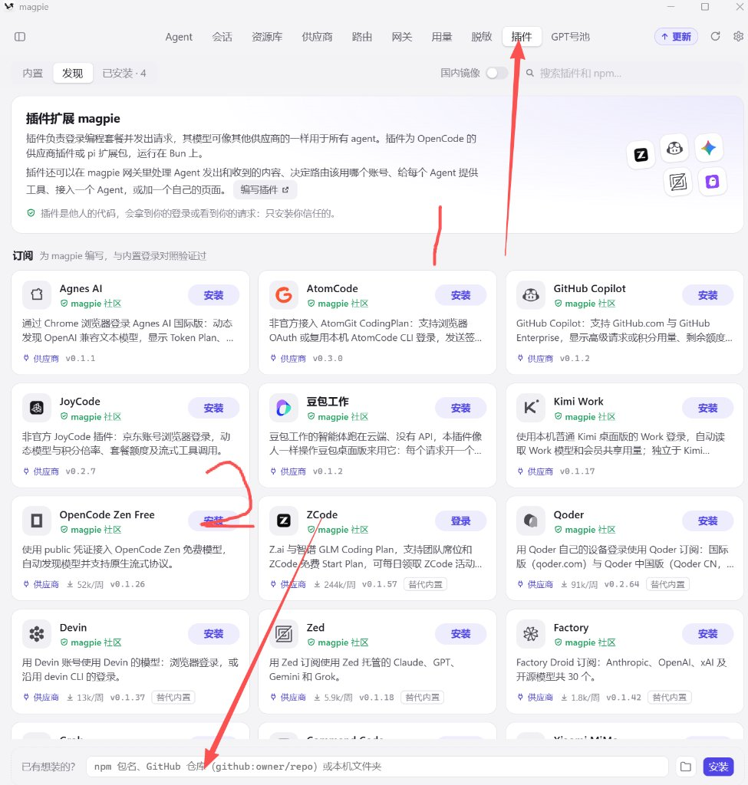
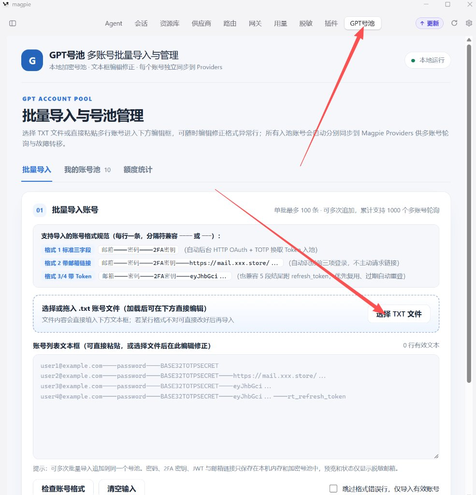

# GPT号池（magpie-gptfree）

> **3 分钟拥有一个自己的 GPT 号池：批量导入、自动轮询、生图额度一目了然。**
>
> 不装环境、不跑浏览器、不用改配置。填个仓库地址，把账号文本粘进去，剩下的插件自己干。

[](https://github.com/yetone/magpie)
[](./package.json)
[](./package.json)

---

## 这玩意儿能干什么

一个 Magpie 插件，把**一堆便宜的 GPT 普号**变成**一个会自动轮询、自动换号、自动重登的号池**：

- **批量导入**：一行一个账号，粘进文本框就行；格式不对可以直接改，不用重新上传文件。
- **多账号真轮询**：每个账号单独出现在 Magpie 里，可单独启用、可设为首选；某个号挂了，自动切下一个。
- **生图真能用**：不只聊天，文生图、改图都能跑，普号的图片额度一样用得上。图片模型覆盖 **GPT Image 2** 与 **GPT Image 2.6 全系列**（`gpt-image-2` / `gpt-image-2.6` / `gpt-image-2.6-flare` / `gpt-image-2.6-sunburst`），2.6 系列还支持生成 GIF 动图。
- **额度看得见**：「我的账号池」每个号旁边直接显示**真实剩余生图额度**；「额度统计」页给你 当前账号 / 可用 / 限流 / 剩余额度 / 成功 / 失败 六个数字。
- **数据不出本机**：凭证加密保存在你自己的电脑上，界面只显示打码邮箱。

> [!IMPORTANT]
> 额度数字全部实时读取自 ChatGPT 官方。**没检测就显示"待检测"，查不到就显示"查询失败"，绝不编造。**

---

## 三毛钱起号池：先备料

号池的原料是普号。**买 GPT 普号可以上 [priceai.cc](https://priceai.cc/)**：

> **三毛钱能买 10 个普号。**

普号同样带图片模型额度，做号池完全够用。买完直接复制提取文本，粘贴进插件就是号池，一分钱都不浪费。

---

## 三步装好，有手就行

### 第 1 步：在 Magpie 里安装插件

打开 Magpie，点顶部 **「插件」** → 切到 **「发现」** → 在最底部的输入框里填入仓库地址：

```
https://github.com/yang0/magpie-gptfree
```

点右边的 **「安装」**，稍等几秒搞定。



> [!TIP]
> 简写 `github:yang0/magpie-gptfree` 同样可以被识别，填哪一个都行。

### 第 2 步：导入账号

安装后，点顶部 **「GPT号池」** 进入自己的号池页面 → **「批量导入」** 标签页：

1. 点 **「选择 TXT 文件」**（或直接把文件拖进虚线框），文件内容会**自动填进下面的文本框**；
2. 如果某几行格式不对，**就在文本框里直接改**——不用重新上传，改完点「检查账号格式」看预览；
3. 勾选「跳过格式错误行，仅导入有效账号」（可选），填好代理（需要的话），点 **「导入并授权入池」**。



全程后台自动登录，**不启动浏览器、不弹网页**。成功的账号会**自动分别同步到 Magpie 的供应商列表**，不用再手动添加。

### 第 3 步：看额度、开用

- 进 **「我的账号池」**：每个账号旁边直接显示 `生图额度：N`、限流状态、恢复时间。
- 进 **「额度统计」**：六个大数字一眼看全局，还能单账号点「检测额度」。
- 回 Magpie 正常选模型聊天 / 画图即可，轮询和故障转移插件全接管。

---

## 支持的账号文本格式

每行一条，分隔符 `----` 与 `---` 都认：

| 格式 | 示例 | 说明 |
| --- | --- | --- |
| 标准三字段 | `邮箱----密码----2FA密钥` | 最常用，直接导入 |
| 带邮箱链接 | `邮箱----密码----2FA密钥----https://mail.xxx.store/...` | 第四段当邮箱链接识别，只用前三段登录，不会访问链接 |
| 带 Token | `邮箱----密码----2FA密钥----eyJhbGci...` | Token 有效就复用；过期会自动重新登录 |
| 五字段带 RefreshToken | `邮箱----密码----2FA密钥----eyJhbGci...----rt_...` | 兼容卡密导出格式，多余字段不外传 |
| 无 2FA | `邮箱----密码` | 能用，但平台额外验证时可能失败 |

> [!WARNING]
> **不要提交真实凭证 TXT 到 GitHub，也不要把账号密码 / 2FA / Token 粘贴到公开聊天记录。** 本仓库已忽略 `accounts*.txt`、`pool.enc.json` 等敏感文件。

---

## 「额度统计」页是什么

一张看板，把号池的健康度摊开给你看：

| 卡片 | 含义 |
| --- | --- |
| **当前账号** | 号池里已入池的账号总数 |
| **可用账号** | 有 Token 且还有剩余生图额度（绿色高亮） |
| **限流账号** | 剩余额度为 0 或已触发限流 |
| **剩余额度** | 所有可用账号的生图剩余额度之和 |
| **成功调用** | 本机累计生图成功次数 |
| **失败调用** | 本机累计生图失败次数 |

外加一张明细表：`账号 / 类型 / 状态 / 剩余生图额度 / 成功·失败 / 最近检测 / 检测额度`。

> [!TIP]
> 如果导入成功但额度一直显示"查询失败"，通常是登录和额度查询走的是两个不同域名，网络通路不一致。在页面顶部填好一个能正常访问 ChatGPT 的 HTTP(S) 代理，再点「刷新全部额度」即可。

---

## 常见问题

**Q：装完点「GPT号池」没反应？**
重启一次 Magpie 让它加载新插件，然后从顶部「插件」或左侧菜单进入。

**Q：需要自己装 Python 吗？**
不需要。插件首次运行会自动准备好运行环境；万一失败会明确报错，不会偷偷失败。

**Q：会动到我 Magpie 里原来的账号吗？**
不会。这是完全独立的临时号池，不碰你原有的配置。

**Q：为什么没有图片模型？**
号池里至少要有 1 个可用账号，图片模型才会出现在模型列表里。可用的图片模型有 `gpt-image-2`、`gpt-image-2.6`、`gpt-image-2.6-flare`、`gpt-image-2.6-sunburst`，其中 2.6 系列支持 GIF 动图输出。

**Q：账号会泄露吗？**
界面上只显示打码邮箱和槽位编号；密码、2FA、Token 只加密存在本机，不写进配置、不进网页、不进日志。

**Q：能不能只导入一个账号？**
可以。单人用也完全没问题，只是没有轮询和故障转移的额外好处。

---

## 关于供应商页面（Providers）

- 在 **GPT号池** 导入账号后，插件会**自动把每个账号分别写进 Magpie 的供应商列表**，日常**不需要去「+ 添加供应商」**重复添加。
- 供应商页里出现 **GPT号池** 是正常的（所有认证类插件都会显示在那里），不是重复项。
- 在供应商页直接点 **GPT号池** 或「重新登录」，会**直接弹出系统文件选择框**：格式全对就直接批量入池；有格式错误行，会自动把文本预加载到左侧菜单「GPT号池」的可编辑文本框，让你改完再导。

---

## 免责声明

本项目为个人自用工具，与 OpenAI 无任何关联。插件只保存**你本人有权使用**的账号凭证，请遵守账号服务条款；因使用不当、批量采购账号或违反上游条款导致的封号、限流等后果由使用者自行承担。

本项目尚未经过真实账号的完整端到端验收，请自行评估使用风险。

MIT License.
